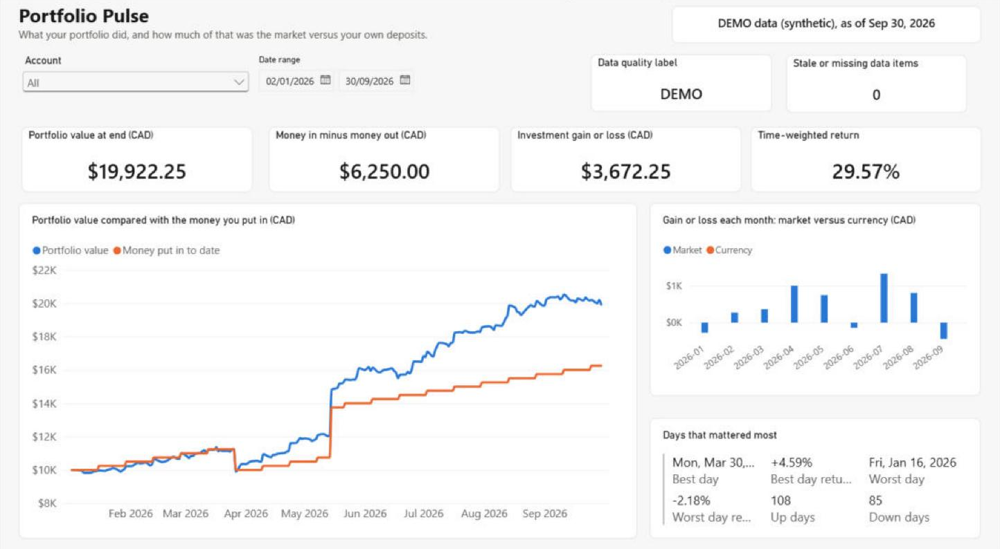

# Portfolio Pulse

[](https://github.com/Rishin05/portfolio-pulse/actions/workflows/ci.yml)

**Showcase page:** https://rishin05.github.io/portfolio-pulse/ (screenshots, how it works, demo `.pbix` download)



An educational, local-first portfolio analytics project: daily portfolio changes that
separate **contributions** from **investment performance**, a calendar of the biggest up
and down days, and a watchlist news feed with links to original articles.

> Educational analytics only. Not investment advice, not a trading system. Demo data is
> synthetic and labelled as such everywhere it appears.

## What's inside

```
portfolio-pulse/
|-- sql/migrations/                 numbered schema migrations (001 baseline, 002 multi-broker)
|-- src/portfolio_pulse/
|   |-- db.py                       connection, migrations, sources, batches, stable IDs
|   |-- synthetic.py                reproducible demo portfolio, cash flows, news
|   |-- synthetic_brokers.py        demo brokers, USD account, activity, holdings, FX, fees
|   |-- csv_import.py               mapping-driven CSV importer with validation
|   |-- news.py                     Finnhub API / Google News RSS / demo fallback
|   |-- export.py                   CSVs for Power BI + data-quality table
|   `-- cli.py                      python -m portfolio_pulse <command>
|-- docs/                           data_dictionary.md, export_contract.md, index.html (showcase page)
|-- powerbi/                        Power BI project: model (TMDL) and report (PBIR) as text files
|-- .github/workflows/ci.yml        tests + demo pipeline + privacy gate on every push
|-- config/                         column-mapping examples (copy and edit)
|-- sample_inputs/                  small CSVs with deliberate errors for testing
|-- scripts/run_daily.ps1|.bat|.sh  scheduler entry points
|-- scripts/reconcile_powerbi.py    SQL control totals for the report's Reconciliation page
|-- tests/                          pytest suite (400 tests)
`-- data/                           inbox/ (your exports), powerbi/ (outputs) - git-ignored
```

## Setup

Requires Python 3.12+.

**Windows (PowerShell)**
```powershell
cd portfolio-pulse
py -3.12 -m venv .venv
.venv\Scripts\Activate.ps1
pip install -r requirements.txt
pip install -e .
copy .env.example .env
```

**macOS / Linux**
```bash
cd portfolio-pulse
python3.12 -m venv .venv
source .venv/bin/activate
pip install -r requirements.txt
pip install -e .
cp .env.example .env
```

## Run it

```bash
python -m pytest -q                         # 400 tests should pass
python -m portfolio_pulse demo              # load synthetic data (re-run: 0 new rows)
python -m portfolio_pulse export            # writes data/powerbi/*.csv
```
See `docs/data_dictionary.md` for every table and column, and `docs/export_contract.md` for the exact CSVs Power BI receives.

### Power BI report

The report is a Power BI project (`powerbi/PortfolioPulse.pbip`): the model and pages are text files, and no data is stored in them.

Build the demo data in its own database, check it, and write the SQL control totals:

```powershell
$env:PULSE_DB_PATH = "$PWD\data\demo\pulse_demo.db"
python -m portfolio_pulse demo
python -m portfolio_pulse performance
python -m portfolio_pulse export --out data\powerbi_demo
Remove-Item Env:PULSE_DB_PATH
python -m portfolio_pulse.demo_gate data\powerbi_demo
python scripts\reconcile_powerbi.py --db data\demo\pulse_demo.db --out data\powerbi_demo
```

Open `powerbi/PortfolioPulse.pbip` in Power BI Desktop, set the `DataFolder` parameter to your
`data\powerbi_demo\` folder (Home → Transform data → Edit parameters; keep the trailing backslash),
then click **Refresh**. The Reconciliation page should show every check as PASS.

Pages: Overview, Calendar, Day detail, Cash flows, FX & fees, News, Data quality, How this works, Reconciliation.

**Sharing rule:** only a `.pbix` saved while `DataFolder` points at the demo folder, and after
`demo_gate` exits 0, is ever shared. `docs/assets/PortfolioPulse-demo.pbix` is that file.

### Your own data (optional)

1. Download an activity export from your broker's website yourself.
2. Put it in `data/inbox/`.
3. Copy `config/column_map.example.json` to `config/column_map.json` and replace the
   example header names with your file's actual headers. Map each transaction-type code
   you see to DEPOSIT / WITHDRAWAL / TRANSFER_IN / TRANSFER_OUT / DIVIDEND / INTEREST / FEE,
   or list it under `ignore_types` (buys and sells).
4. Validate first: `python -m portfolio_pulse import-csv data/inbox/<file>.csv --map config/column_map.json --dry-run`
5. Fix the mapping until rejects make sense, then run without `--dry-run`.

Never put brokerage usernames, passwords or tokens in this project.

### News

* No setup: demo headlines (all start with `[DEMO]` and link to example.com).
* Finnhub: add a free key to `.env` as `FINNHUB_API_KEY`, then `python -m portfolio_pulse fetch-news`.
* Google News RSS (personal, non-commercial): `python -m portfolio_pulse fetch-news --source rss`.

### Schedule it

* Windows: Task Scheduler → Create Task → weekdays at 18:00 → Action "Start a program" →
  `powershell.exe -NoProfile -ExecutionPolicy Bypass -File scripts\run_daily.ps1`.
  Each step runs on its own, so one failure never blocks the rest. "Last Run Result" shows the exit
  code: 0 all steps OK, 1 some steps failed but the export ran, 2 the export failed, 3 already running.
* macOS/Linux: `crontab -e` and add the line shown at the top of `scripts/run_daily.sh`.
* Manual run any time: `python -m portfolio_pulse run-daily`.

Logs go to `logs/portfolio_pulse.log`.
